# CouchPlay

[](https://github.com/Lukas20039/couchplay/actions/workflows/ci.yml)
[](https://github.com/Lukas20039/couchplay/actions/workflows/docker.yml)
[](https://github.com/Lukas20039/couchplay/actions/workflows/apk.yml)
[](LICENSE)

**Der Fernseher ist die Spielkonsole, die Smartphones sind die Controller.**
Partyspiele für 1–8 Personen auf dem Android TV, gesteuert mit dem eigenen Handy,
ganz ohne App-Installation am Handy. Vorbild: Netflix Games und Jackbox.

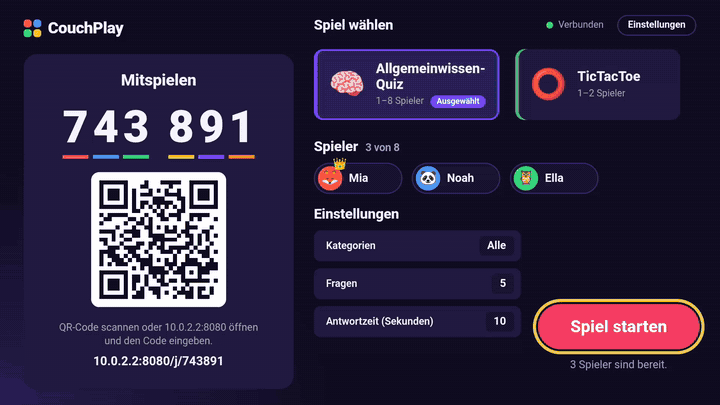

## So funktioniert's

1. **TV-App starten.** Der Fernseher zeigt einen 6-stelligen Code und einen QR-Code.
2. **Handy beitreten.** QR-Code scannen oder die Adresse öffnen und den Code eintippen,
   Namen und Avatar wählen. Läuft im Browser auf iPhone und Android und lässt sich als PWA
   auf den Home-Bildschirm legen.
3. **Spielen.** Wer zuerst beitritt, ist Host und wählt Spiel und Einstellungen –
   am Handy oder mit der TV-Fernbedienung.

| TV: Lobby mit Code und QR | Handy: Beitreten |
|---|---|
| 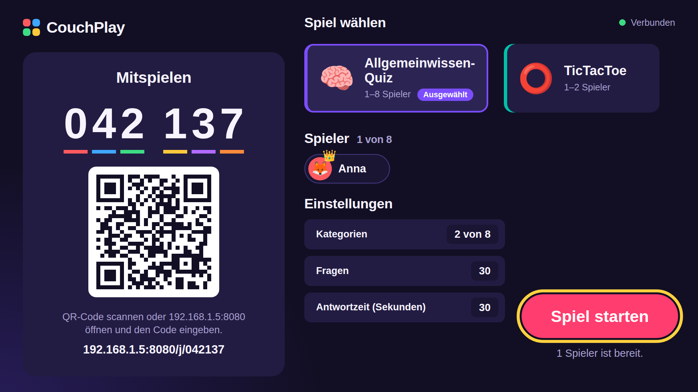 | 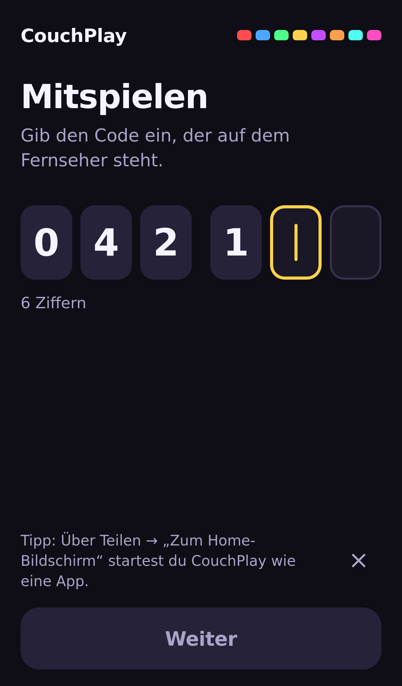 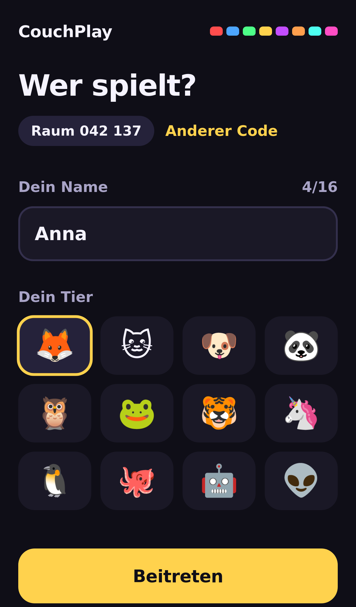 |

## Spiele

### 🧠 Allgemeinwissen-Quiz · 1–8 Spieler

370 deutsche Fragen in 8 Kategorien. Frage und Countdown am TV, vier farbige Antworttasten am
Handy – Farbe **und** Form, damit es auch bei Farbenblindheit funktioniert. Wer schneller
richtig antwortet, bekommt mehr Punkte. Nach jeder Frage Auflösung und Zwischenstand,
am Ende ein Podium.

| Frage am TV | Auflösung am TV | Handy |
|---|---|---|
| 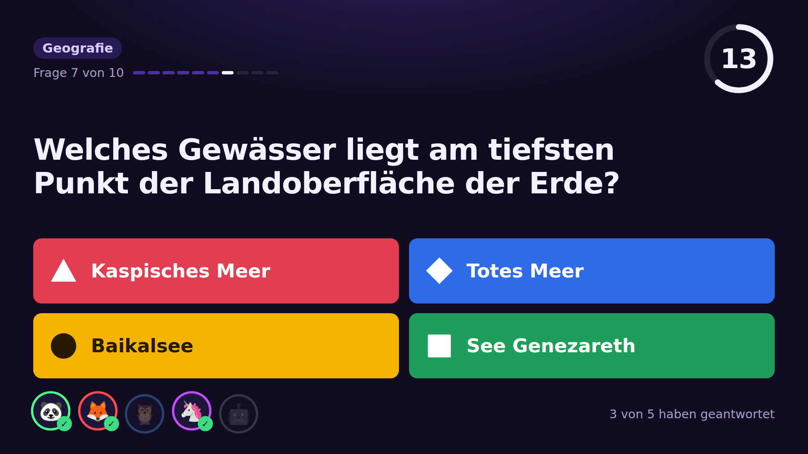 | 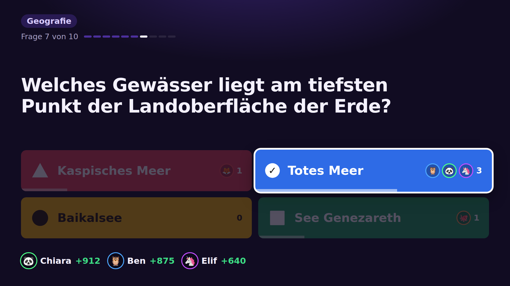 | 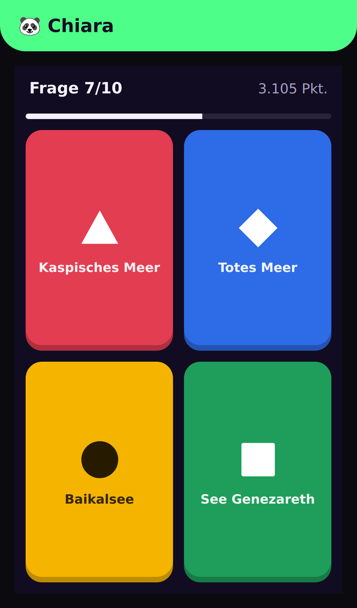 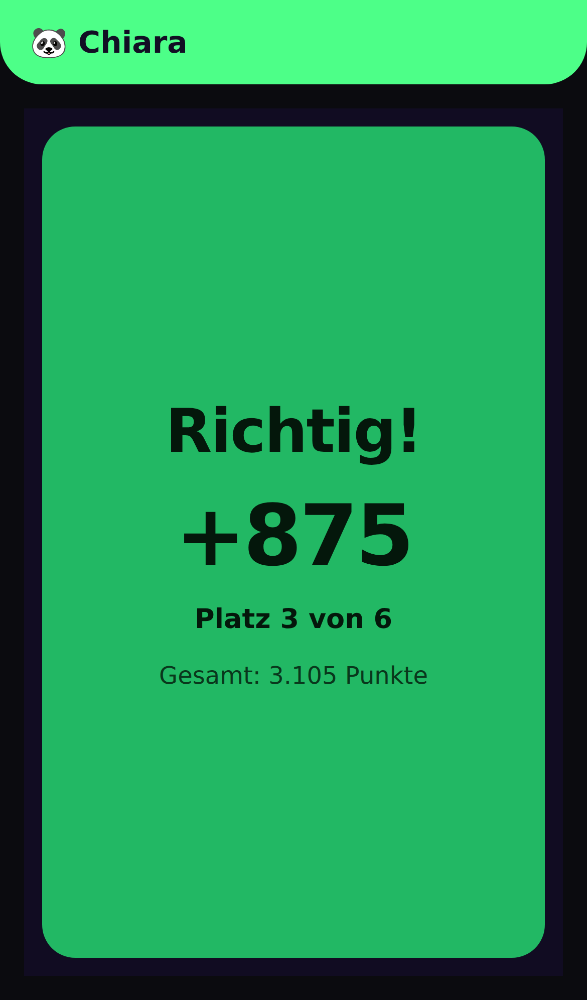 |

### ⭕ TicTacToe · 1–2 Spieler

Allein gegen den Computer (leicht, mittel oder unbesiegbar) oder zu zweit Handy gegen Handy,
mit Revanche und Serienstand. Der „unbesiegbare“ Computer spielt perfekt – getestet über alle
16 752 möglichen Spielverläufe.

| TV | Handy |
|---|---|
| 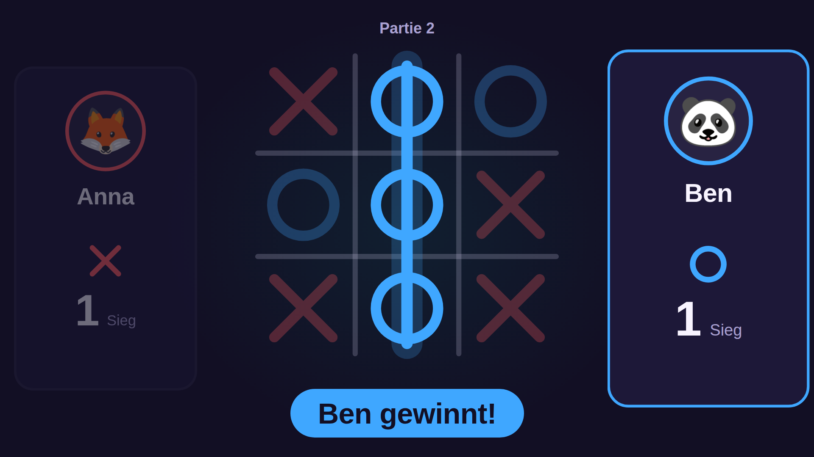 | 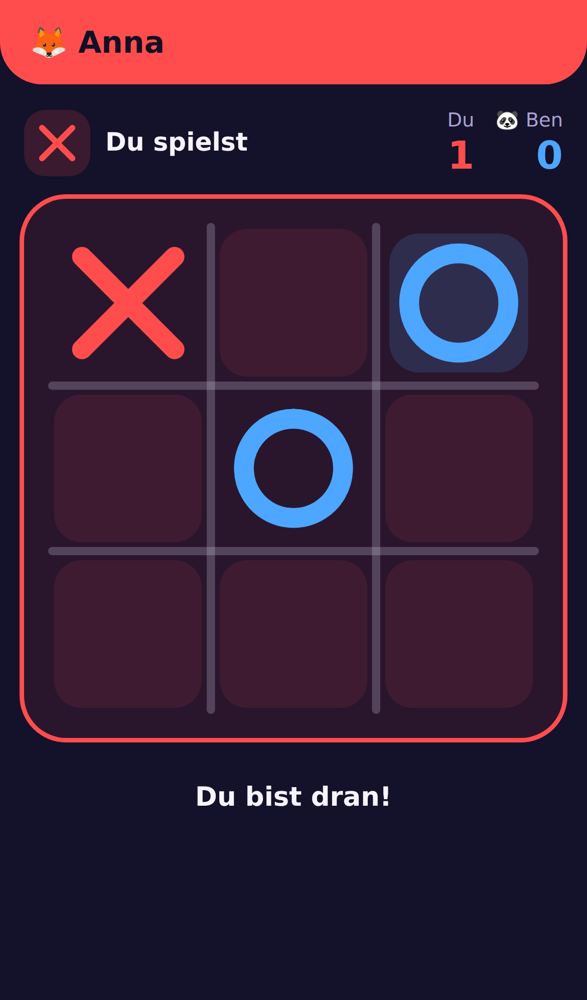 |

### 🌻 Wortgarten · 1–8 Spieler

Gemütliches Wortsuch-Battle: Alle suchen gleichzeitig Wörter im selben Buchstabenraster und wischen
dafür am Handy über benachbarte Buchstaben – waagrecht, senkrecht und **schräg**. Lange Wörter,
Goldfelder und schnelle Serien (Combo) bringen Multiplikatoren, Wörter, die sonst niemand gefunden hat,
zählen doppelt. Am TV wächst dabei für jedes Wort eine Blume im eigenen Beet, die Wörter bleiben bis zur
Ernte geheim. Mit jedem Spiel wächst der Garten und schaltet nach und nach Tipps, 5 × 5- und 6 × 6-Raster,
Goldfelder sowie Blitz- und Langwort-Modus frei. Rund 410 000 deutsche Wortformen
([LanguageTool](https://github.com/languagetool-org/german-pos-dict), CC BY-SA 4.0).

| TV | Handy |
|---|---|
| 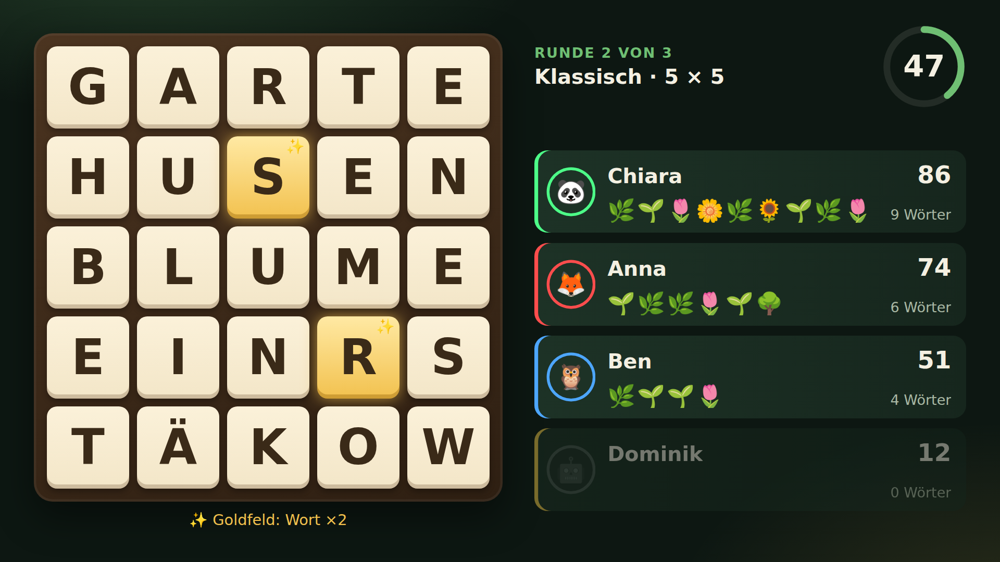 | 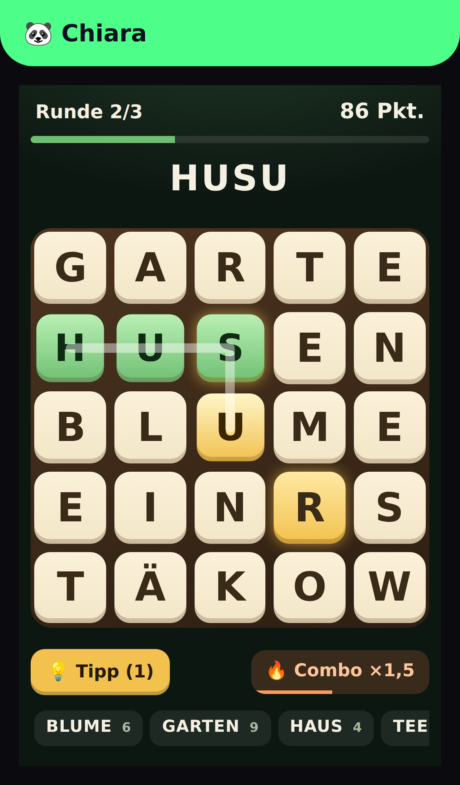 |

### Ergebnis

| TV | Host-Handy in der Lobby |
|---|---|
| 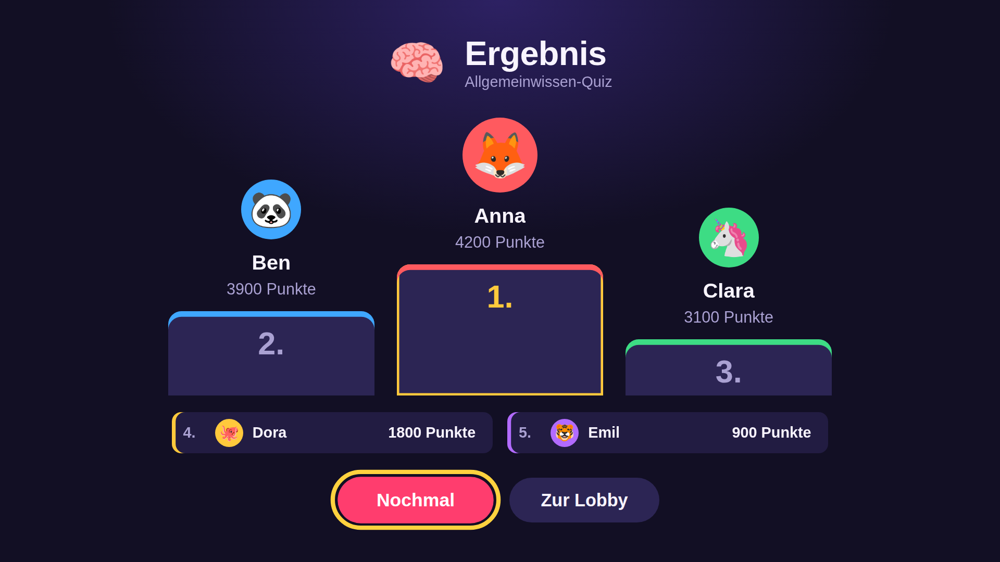 | 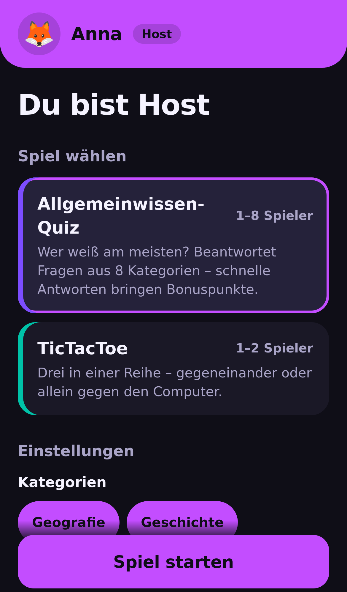 |

## Installation

### Server (Docker)

Bei jedem Push auf `main` und bei jedem Release baut GitHub Actions ein Multi-Arch-Image
(amd64/arm64) und veröffentlicht es in der GitHub Container Registry:

```bash
docker run -d --name couchplay -p 8080:8080 \
  -e PUBLIC_URL=https://play.example.com \
  -e TRUST_PROXY=1 \
  ghcr.io/lukas20039/couchplay:latest
```

| Tag | Inhalt |
|---|---|
| `latest` | aktueller Stand von `main` (nur nach grünen Tests) |
| `0.1.0`, `0.1` | feste Release-Versionen |
| `sha-…` | einzelner Commit |

**HTTPS ist Pflicht für den Produktivbetrieb:** iOS installiert die PWA nur über HTTPS.
Beispiele für Caddy, Traefik und nginx, alle Umgebungsvariablen und die Sicherheits-Limits
stehen in [`docs/deploy.md`](docs/deploy.md). Fürs Heimnetz ohne Domain reicht auch
`http://<IP-des-Servers>:8080`.

### Android TV

Die signierte APK hängt an jedem [Release](https://github.com/Lukas20039/couchplay/releases).
Auf dem TV z. B. mit der App *Downloader* öffnen oder per `adb install couchplay-tv-*.apk`.
Die App erscheint im Android-TV-Launcher. Die Server-Adresse ist voreingestellt und lässt sich
in der App unter **Einstellungen** ändern (langer Druck auf Zurück, Menütaste oder langer Druck auf OK).
Ist der Server beim ersten Start nicht erreichbar, fragt die App die Adresse direkt ab.

**Updates kommen danach von selbst:** Beim Start prüft die App das neueste GitHub-Release und bietet
die neue Version an; alternativ *Einstellungen → Nach Updates suchen*. Beim ersten Update fragt
Android einmalig, ob CouchPlay Apps installieren darf. (Versionen bis 0.1.2 haben das noch nicht und
müssen einmal von Hand aktualisiert werden.)

<details>
<summary>Screenshot aus dem Android-TV-Emulator</summary>

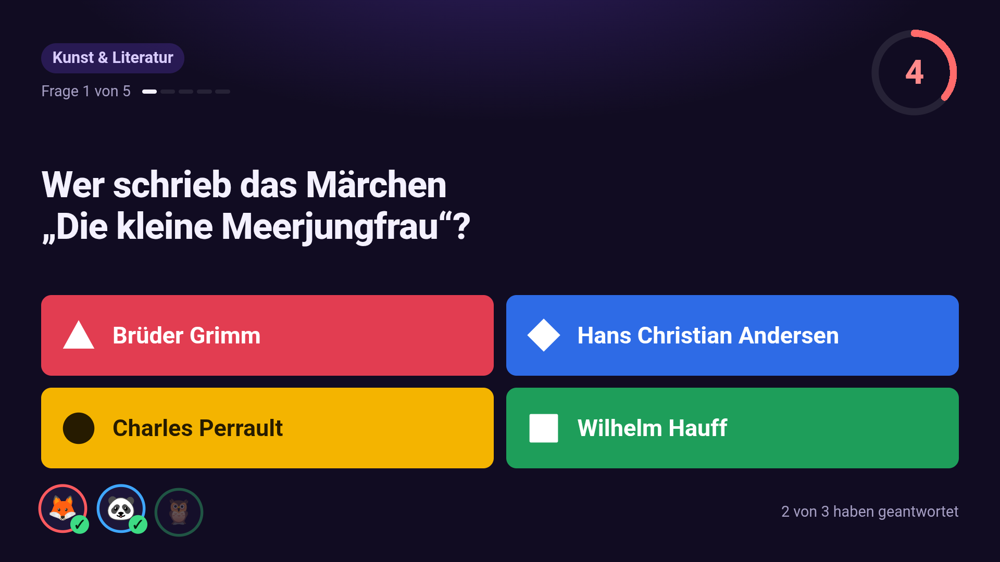
</details>

### Handys

Nichts installieren: QR-Code am TV scannen. Optional über *Teilen → Zum Home-Bildschirm*
(iOS) bzw. *App installieren* (Android) als App ablegen.

## Architektur

```
┌──────────────┐  WebSocket  ┌──────────────────────┐  WebSocket  ┌──────────────┐
│ Android TV   │◄───────────►│ Game-Server (Node)   │◄───────────►│ Handy-PWA    │
│ Kotlin-Hülle │             │ Räume, Codes,        │             │ Controller   │
│ + WebView    │             │ Spiellogik, Katalog  │             │ iOS/Android  │
└──────────────┘             └──────────────────────┘             └──────────────┘
```

- **Server** (Fastify + `ws`, TypeScript) entscheidet alles: Die Spiellogik läuft nur dort,
  Handys senden nur Eingaben. Er liefert auch TV-Oberfläche und PWA aus.
- **TV-App** ist eine schlanke Kotlin-Hülle (75 KB) mit Vollbild-WebView; die Oberfläche kommt
  vom Server, neue Spiele brauchen also kein App-Update.
- **Spiele** sind Pakete aus Manifest, Serverlogik, TV-Ansicht und Controller-Ansicht
  ([`packages/game-sdk`](packages/game-sdk)).

| Pfad | Inhalt |
|---|---|
| [`server/`](server) | Game-Server, Räume, Rate-Limits, Auslieferung der Web-Apps |
| [`tv-web/`](tv-web) | TV-Oberfläche (Preact), komplett per Fernbedienung bedienbar |
| [`controller-pwa/`](controller-pwa) | Handy-Controller als PWA |
| [`android-tv/`](android-tv) | Android-TV-App (Kotlin) |
| [`games/quiz/`](games/quiz), [`games/tictactoe/`](games/tictactoe) | die Spiele |
| [`packages/protocol/`](packages/protocol) | WebSocket-Protokoll (zod-Schemas) |
| [`packages/game-sdk/`](packages/game-sdk) | Schnittstelle und Laufzeit für Spiele |
| [`e2e/`](e2e) | End-to-End-Tests im Browser und im Android-TV-Emulator |

Details: [Architektur](docs/architecture.md) · [Protokoll](docs/protocol.md) ·
[Deployment](docs/deploy.md) · [Regeln für Beiträge](AGENTS.md)

## Entwicklung

Voraussetzungen: Node 22, für die TV-App zusätzlich Java 21 und das Android SDK.

```bash
npm install --include=dev
npm run build      # Server-Bundle + TV-Oberfläche + PWA
npm start          # http://localhost:8080 – TV: /tv/, Handy: /
```

Mit Live-Reload: `npm run dev` (Server, Port 8080), `npm run dev:tv` (5173),
`npm run dev:controller` (5174). TV-App bauen: `cd android-tv && ./gradlew assembleDebug`
(Server-Adresse per `-Pcouchplay.serverUrl=http://<IP>:8080`, Default ist der Host aus
Sicht des Emulators).

### Tests

| Befehl | Was |
|---|---|
| `npm run typecheck` | TypeScript in allen Paketen |
| `npm test` | ~500 Unit- und Integrationstests (Vitest, echte WebSocket-Clients) |
| `npm run test:e2e` | Playwright: TV in Chromium, bis zu 8 Handys in Chromium (Pixel 7) und WebKit (iPhone 13) – QR-Join, komplette Spiele, Verbindungsabbrüche |
| `npm run test:emulator` | Android-TV-Emulator: APK installieren, Bedienung per Fernbedienungs-Tasten, QR aus dem Bildschirmfoto, Spiele mit echten Handy-Browsern (nur lokal) |

Einzelheiten und Fehlerbehebung: [`e2e/README.md`](e2e/README.md).

## Release

Ein Versions-Tag veröffentlicht alles auf einmal:

```bash
git tag v0.2.0
git push origin v0.2.0
```

- **Docker** → `ghcr.io/lukas20039/couchplay:0.2.0` und `:0.2` (nur nach grünen Tests und
  erfolgreichem Smoke-Test des Containers).
- **APK** → signierte Release-APK samt SHA-256-Prüfsumme am GitHub-Release, mit
  Installationshinweisen und automatisch erzeugten Änderungsnotizen.
  `versionName` kommt aus dem Tag, `versionCode` = Major·10⁶ + Minor·10³ + Patch.

Einmalige Einrichtung im Repository (*Settings → Secrets and variables → Actions*):

| Name | Art | Zweck |
|---|---|---|
| `ANDROID_KEYSTORE_BASE64` | Secret | Release-Keystore, base64-kodiert |
| `ANDROID_KEYSTORE_PASSWORD`, `ANDROID_KEY_ALIAS`, `ANDROID_KEY_PASSWORD` | Secret | Zugang zum Schlüssel |
| `COUCHPLAY_SERVER_URL` | Variable | voreingestellte Server-Adresse der TV-App, z. B. `https://play.example.com` |

Ohne Signatur-Secrets bricht ein Tag-Build bewusst ab: Eine mit wechselndem Debug-Schlüssel
signierte APK ließe sich später nicht mehr aktualisieren.

## Lizenz

[MIT](LICENSE) © 2026 Lukas Grundtner. Übernommene Agent- und Skill-Dateien unter
`.claude/` stehen unter ihren eigenen Lizenzen (MIT bzw. Apache 2.0), siehe
`.claude/SOURCES.txt`. Die Wortliste von Wortgarten stammt aus dem LanguageTool-Wörterbuch und steht
unter CC BY-SA 4.0, siehe [`games/wortgarten/DATA-LICENSE.md`](games/wortgarten/DATA-LICENSE.md).
